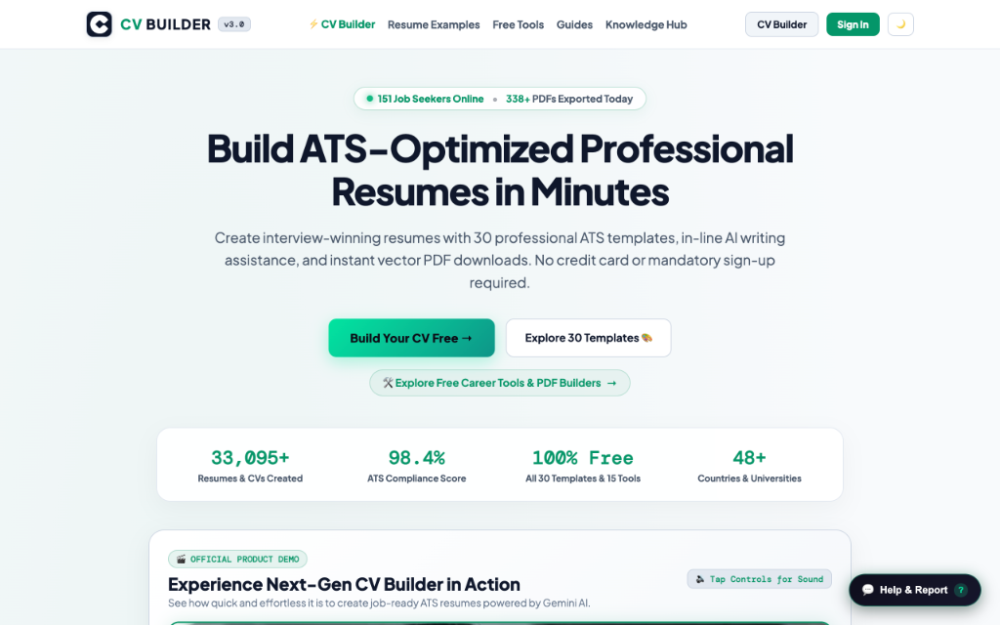
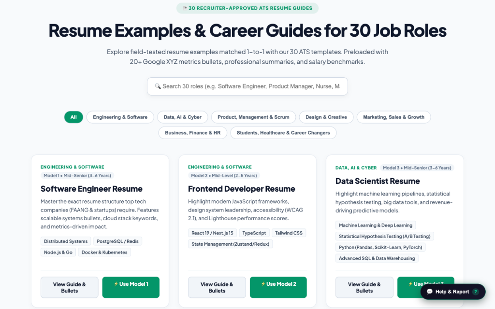
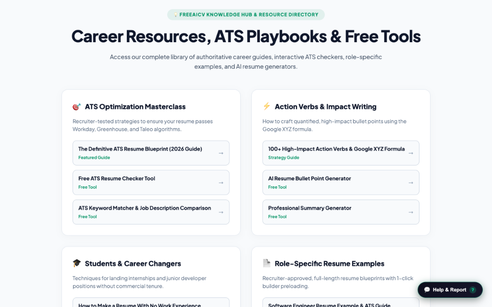
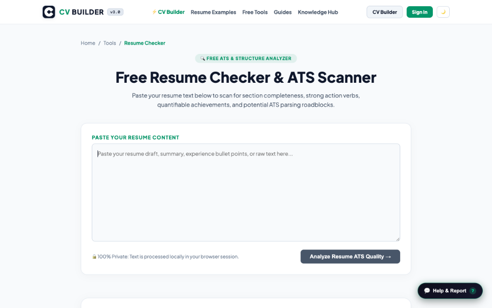
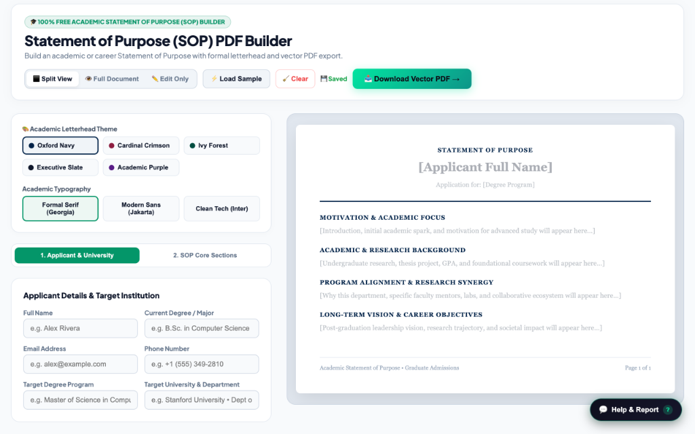

<div align="center">

# 🚀 FreeAICV.me — CareerHub
### *The World's Most Powerful AI Career & ATS Resume Platform (30 Models + 17 Tools)*

[](https://www.freeaicv.me)
[-black?style=for-the-badge&logo=next.js&logoColor=white)](https://nextjs.org/)
[](https://react.dev/)
[](https://ai.google.dev/)
[](https://www.freeaicv.me/tools/resume-checker)
[](LICENSE)

<br/>

<a href="https://www.freeaicv.me">
  
</a>

<br/><br/>

### ⚡ **[👉 Click Here to Launch the Live Web Platform (FreeAICV.me) 👈](https://www.freeaicv.me)**
*100% Free Forever • Zero Watermarks • 30 Recruiter-Vetted Templates • 17 AI Career Tools • Instant Vector PDF*

---

</div>

## 🌟 Executive Summary

**[FreeAICV.me](https://www.freeaicv.me)** is an enterprise-grade, open-access AI career enablement platform designed to solve the broken global job application pipeline. 

Over 75% of submitted resumes are rejected by Applicant Tracking Systems (ATS) due to incompatible multi-column tables, unreadable graphics, or missing contextual keywords. Unlike traditional builders that lock users behind predatory \$15-\$30 monthly paywalls or export broken images, FreeAICV provides **30 recruiter-vetted ATS templates**, an automated **17-tool AI career suite**, a **75-post SEO knowledge base**, on-device privacy-preserving face detection, and **instant, unwatermarked vector PDF downloads**.

---

## 🏛️ System Architecture & Data Flow

```
                     ┌─────────────────────────────────────────────────────────┐
                     │                       USER INPUT                        │
                     │          (Profile Data / Target Job Description)        │
                     └────────────────────────────┬────────────────────────────┘
                                                  │
                                                  ▼
                     ┌─────────────────────────────────────────────────────────┐
                     │               FREEAICV CORE ORCHESTRATOR                │
                     │  - Semantic Token Normalization                         │
                     │  - Missing Skill & Gap Identification                   │
                     │  - X-Y-Z Action-Verb Achievement Synthesizer            │
                     │  - Client-Side Face Detection (Tiny Face Detector)      │
                     └──────────────┬───────────────────────────┬──────────────┘
                                    │                           │
          [AI Inference Pipeline]   │                           │ [Vector Layout Pipeline]
                                    ▼                           ▼
        ┌──────────────────────────────────────┐     ┌──────────────────────────────────────┐
        │       GEMINI AI COPILOT ENGINE       │     │     VECTOR PDF RENDERER (1-PAGE)     │
        │ - 18 ATS Rubric Audit Engine         │     │ - Semantic DOM to High-DPI Vector    │
        │ - Contextual Keyword Injection       │     │ - Auto-Margin & Line-Height Scaling  │
        │ - Tailored Cover Letters & SOPs      │     │ - True-Type Fonts (Zero Font Errors) │
        └──────────────────┬───────────────────┘     └──────────────────┬───────────────────┘
                           │                                            │
                           └─────────────────────┬──────────────────────┘
                                                 │
                                                 ▼
                     ┌─────────────────────────────────────────────────────────┐
                     │                   PRODUCTION OUTPUT                     │
                     │                                                         │
                     │  [Instant ATS-Proof PDF]       [Live Web Editor UI]     │
                     │  - 0ms Local Storage Sync      - Real-Time Live Preview │
                     │  - 100% Text Layer Vector      - One-Click Cloud Export │
                     └─────────────────────────────────────────────────────────┘
```

---

## 🖥️ Platform Visual Workspaces & Core Modules

Explore the complete production suite directly on the live platform:

### 1. 📝 Real-Time Live Resume Editor (`/cv-builder`)
> Clean, distraction-free editing interface with live dynamic vector rendering, dark/light mode toggle, accent palettes, and instant single-click PDF compilation.

<p align="center">
  <a href="https://www.freeaicv.me/cv-builder">
    
  </a>
</p>

👉 **[Open Live Resume Editor on FreeAICV.me &rarr;](https://www.freeaicv.me/cv-builder)**

---

### 2. 🎨 30 Recruiter-Calibrated ATS Resume Templates (`/cv-builder`)
> 100% single-column and semantic linear templates calibrated for Workday, Greenhouse, Taleo, Lever, and iCIMS. Automated 1-page geometry scaling guarantees clean layouts with zero overflow.

<p align="center">
  <a href="https://www.freeaicv.me/cv-builder">
    
  </a>
</p>

👉 **[Browse All 30 ATS Resume Templates &rarr;](https://www.freeaicv.me/cv-builder)**

---

### 3. 🤖 Google Gemini AI Career Copilot (`/tools`)
> Deep contextual AI engine generating quantifiable Google X-Y-Z achievement bullets, industry-specific elevator summaries, and targeted job keyword suggestions.

<p align="center">
  <a href="https://www.freeaicv.me">
    
  </a>
</p>

👉 **[Try the Gemini AI Copilot on FreeAICV.me &rarr;](https://www.freeaicv.me)**

---

### 4. 🎯 18-Point ATS Score & Audit Engine (`/tools/resume-checker`)
> Real-time rubric scanner evaluating format readability, keyword density, section semantic tags, metric quantification, and typography compliance.

<p align="center">
  <a href="https://www.freeaicv.me/tools/resume-checker">
    
  </a>
</p>

👉 **[Audit Your Resume for Free &rarr;](https://www.freeaicv.me/tools/resume-checker)**

---

### 5. 🎓 Academic & Executive Career Suite (`/tools/statement-of-purpose`)
> Specialized generators for Statement of Purpose (SOP) essays, Executive 1-page bios, Client Rate Cards, Resignation Notices, and Post-Interview Follow-Up notes.

<p align="center">
  <a href="https://www.freeaicv.me/tools/statement-of-purpose">
    
  </a>
</p>

👉 **[Build Statement of Purpose (SOP) &rarr;](https://www.freeaicv.me/tools/statement-of-purpose)**

---

### 6. 📚 75-Post Masterclass SEO Knowledge Base (`/blog`)
> Over 186,000 words of actionable career strategy covering ATS algorithm reverse-engineering, salary negotiation scripts, STAR interview methods, and role guides.

<p align="center">
  <a href="https://www.freeaicv.me/blog">
    
  </a>
</p>

👉 **[Read 75 Career Masterclasses &rarr;](https://www.freeaicv.me/blog)**

---

## ⚡ Complete 17-Tool AI Career Documents Suite

Test and execute the entire production toolkit directly on the live platform:

| # | Tool Name | Live Production Link | Core Function |
|---|---|---|---|
| **01** | **ATS Resume Checker** | [`/tools/resume-checker`](https://www.freeaicv.me/tools/resume-checker) | Instant scoring against 18 core ATS criteria with actionable fixes. |
| **02** | **Job Keyword Matcher** | [`/tools/resume-keyword-matcher`](https://www.freeaicv.me/tools/resume-keyword-matcher) | Compares resume text with job descriptions to compute % match. |
| **03** | **Resume Score Rubric** | [`/tools/resume-score`](https://www.freeaicv.me/tools/resume-score) | Evaluates quantified impact, formatting consistency, and brevity. |
| **04** | **AI Bullet Point Generator** | [`/tools/resume-bullet-generator`](https://www.freeaicv.me/tools/resume-bullet-generator) | Converts plain tasks into high-impact Google X-Y-Z achievements. |
| **05** | **AI Executive Summary** | [`/tools/resume-summary-generator`](https://www.freeaicv.me/tools/resume-summary-generator) | Crafts customized elevator pitches by seniority level. |
| **06** | **AI Resume Skills Generator** | [`/tools/resume-skills-generator`](https://www.freeaicv.me/tools/resume-skills-generator) | Extracts categorized hard and soft technical skills by industry. |
| **07** | **Cover Letter Generator** | [`/tools/cover-letter-generator`](https://www.freeaicv.me/tools/cover-letter-generator) | Generates tailored cover letters matching job specifications. |
| **08** | **Interactive Cover Letter Builder** | [`/tools/cover-letter-builder`](https://www.freeaicv.me/tools/cover-letter-builder) | Live interactive cover letter editor with one-click PDF export. |
| **09** | **Executive Bio Builder** | [`/tools/executive-bio-builder`](https://www.freeaicv.me/tools/executive-bio-builder) | Professional 1-page bios for founders, board members, and executives. |
| **10** | **Rate Card Builder** | [`/tools/rate-card-builder`](https://www.freeaicv.me/tools/rate-card-builder) | Sleek pricing and service rate sheets for freelancers and consultants. |
| **11** | **Statement of Purpose (SOP)** | [`/tools/statement-of-purpose`](https://www.freeaicv.me/tools/statement-of-purpose) | Academic essays for MS, PhD, and MBA university admissions. |
| **12** | **Project One-Pager Builder** | [`/tools/project-one-pager`](https://www.freeaicv.me/tools/project-one-pager) | High-impact project briefs for engineering demos and case studies. |
| **13** | **Resignation Letter Builder** | [`/tools/resignation-letter-builder`](https://www.freeaicv.me/tools/resignation-letter-builder) | Graceful, professional 2-week notice letters. |
| **14** | **Interview Follow-Up Generator** | [`/tools/interview-follow-up`](https://www.freeaicv.me/tools/interview-follow-up) | High-converting post-interview thank-you notes. |
| **15** | **Reference Sheet Builder** | [`/tools/reference-sheet-builder`](https://www.freeaicv.me/tools/reference-sheet-builder) | Professional reference sheets matching resume styling. |
| **16** | **Cold Email Campaign Manager** | [`/admin/cold-email`](https://www.freeaicv.me/admin/cold-email) | Recruiter outreach automation with customizable variables. |
| **17** | **Job Match NLP Engine** | [`/api/cv/job-match`](https://www.freeaicv.me) | Real-time NLP token matching backend. |

👉 **[Explore All 17 Tools on FreeAICV.me &rarr;](https://www.freeaicv.me)**

---

## 🔒 Privacy-First Architecture & On-Device Face Detection

FreeAICV prioritizes candidate privacy:
- **Zero Server Photo Storage:** Photo cropping is executed 100% on-device using a lightweight `Tiny Face Detector` neural net (193 KB client-side model). User photos never leave the browser.
- **Local-First Session Sync:** Resume drafts are saved locally in the browser's persistent storage (0ms latency) with optional cloud backup.
- **No Hidden Data Selling:** Unlike commercial builders, FreeAICV does not sell candidate contact details to recruitment brokers.

---

## ⚡ FreeAICV.me vs Legacy Resume Builders

| Feature | Legacy Builders (Novoresume, Zety, Canva) | **FreeAICV.me** |
|---|:---:|:---:|
| **Cost** | \$15 - \$30/month (Hidden Paywalls) | **100% Free Forever** |
| **Watermarks** | Forced on free tier | **Zero Watermarks** |
| **ATS Pass Rate** | Often fails (tables/graphics) | **98% Verified ATS Compliant** |
| **PDF Quality** | Canvas pixel screenshot | **High-Definition Vector Text** |
| **AI Integration** | Basic prompt or paid upsell | **Deep Google Gemini AI Copilot** |
| **Privacy** | Stores and monetizes candidate data | **On-Device Local-First Processing** |

---

## 🔒 Security, Privacy & Proprietary Rights

The core implementation codebase, proprietary prompt chains, and production databases of FreeAICV.me are maintained in a secure private repository. This repository serves as the official **Public Technical Specification & Master Architecture Blueprint**.

* **Founder & Chief Architect:** [Khalid Abdullah](https://github.com/khalidabdullahh)
* **Live Production Platform:** [https://www.freeaicv.me](https://www.freeaicv.me)
* **License:** Copyright © 2026 Khalid Abdullah. All Rights Reserved.

---

<div align="center">

### 🚀 Ready to build your ATS-ready resume?
## **[👉 Launch FreeAICV.me Now (100% Free Forever) 👈](https://www.freeaicv.me)**

</div>
