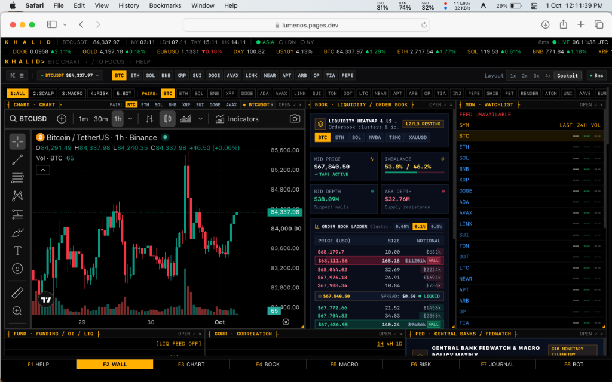
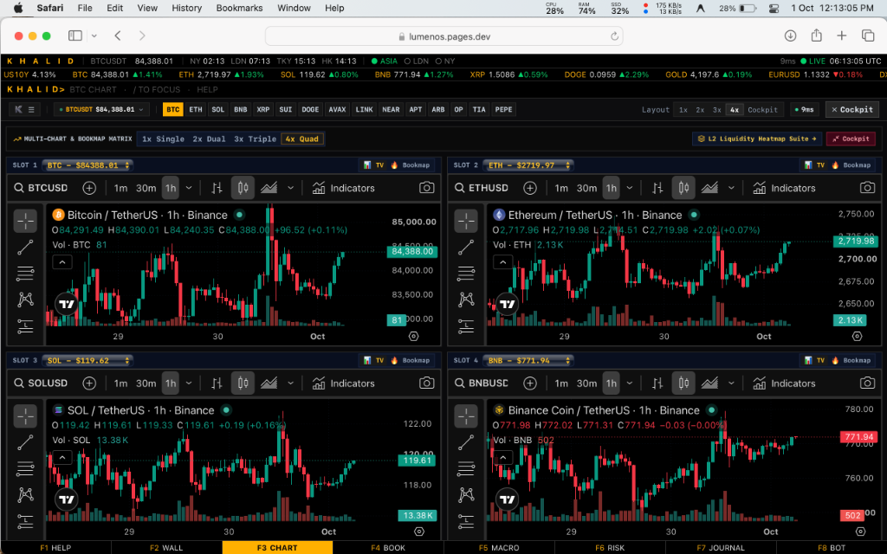
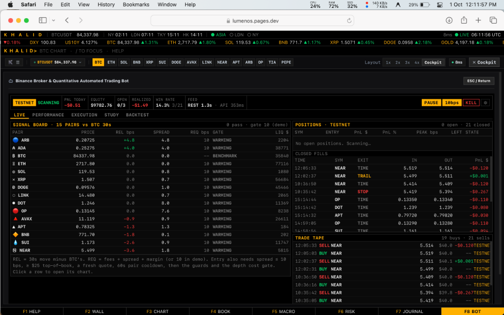
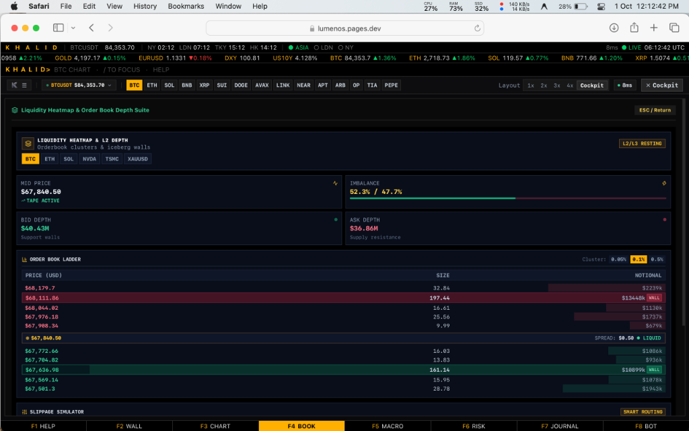
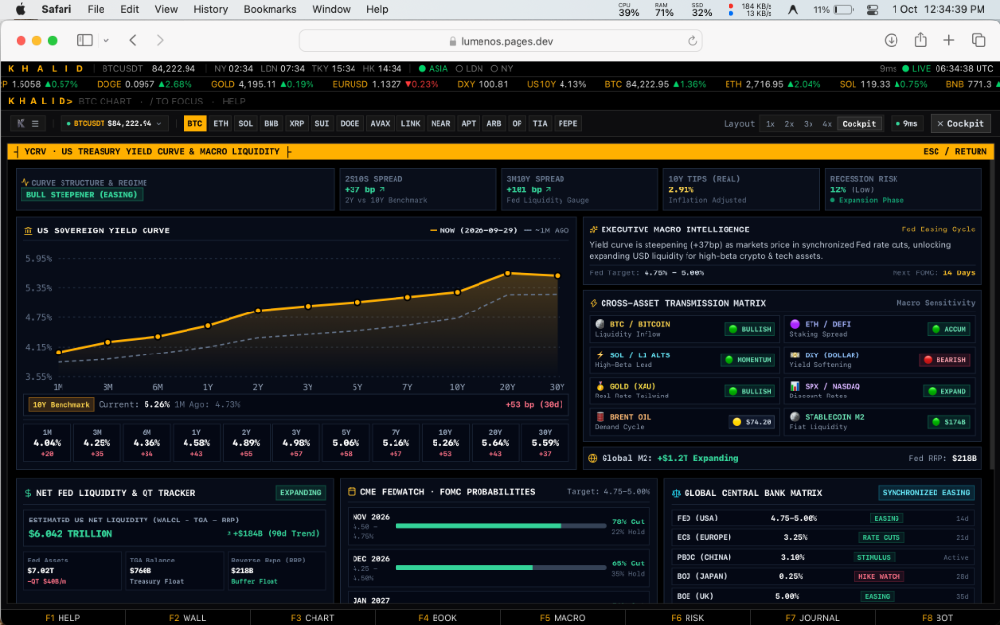

<div align="center">

# ⚡ Lumen OS — Institutional Quantitative Terminal
### *Bloomberg-Style Modular Master Workstation & Algorithmic Trading Desk*

[](https://trading-os-blue.vercel.app)
[](docs/LUMEN_OS_INSTITUTIONAL_WHITEPAPER_v2.02.pdf)
[](https://www.typescriptlang.org/)
[](https://react.dev/)
[](https://neon.tech/)
[](https://cloudflare.com/)

<br/>

<a href="https://trading-os-blue.vercel.app">
  
</a>

<br/><br/>

### ⚡ **[👉 Click Here to Launch the Live Terminal Workstation (trading-os-blue.vercel.app) 👈](https://trading-os-blue.vercel.app)**
*High-Frequency L2 Streaming • 12-Module Bloomberg Grid • Autonomous Quant Bot • 0ms Local-First Execution*

---

</div>

## 🏛️ Executive Summary

**[Lumen OS](https://trading-os-blue.vercel.app)** is a single-screen, institutional-grade **Quantitative Trading Terminal & Bloomberg-Style Modular Master Workstation** engineered for proprietary trading desks, quantitative researchers, and active digital asset traders.

It unites ultra-low-latency **Local-First (0ms Execution)** telemetry with **Cloudflare Zero Trust Access** and **Neon PostgreSQL Serverless Cloud Synchronization**, providing institutional traders with unmatched speed, deep market visibility, and automated algorithmic execution.

📄 **Institutional Technical Whitepaper:** Download the comprehensive [Lumen OS Quantitative Architecture Whitepaper v2.02 (PDF)](docs/LUMEN_OS_INSTITUTIONAL_WHITEPAPER_v2.02.pdf).

---

## 🛰️ Quantitative System Architecture

```
                     ┌──────────────────────────────────────────────────────────┐
                     │           LUMEN OS LOCAL WORKSTATION (Mac / PC)          │
                     │  - React 18 + TypeScript + Vite + Tailwind               │
                     │  - Zero-Latency Local Vault (SSD / localStorage)         │
                     │  - High-Speed Web Audio Tactical Sound Synthesizer       │
                     └─────────────┬──────────────────────────────┬─────────────┘
                                   │                              │
         [Real-Time L2 Market Feed]│                              │[Local Node Proxy / Runner]
                                   ▼                              ▼
                 ┌───────────────────────────┐      ┌───────────────────────────┐
                 │  Binance L2 Data Feeds    │      │ Local Runner (Node.js)    │
                 │  - WSS bookTicker streams │      │ - scripts/local-runner.cjs│
                 │  - REST L2 Depth (20-lvl) │      │ - process.env (CF Auth)   │
                 └───────────────────────────┘      └─────────────┬─────────────┘
                                                                  │
                                            [Service Token Auth: CF-Access-Client-Id]
                                                                  ▼
                                                    ┌───────────────────────────┐
                                                    │ Cloudflare Zero Trust     │
                                                    │ https://lumenos.pages.dev │
                                                    │ - /api/binance/proxy      │
                                                    │ - /api/fred/yields        │
                                                    │ - /api/alerts/notify      │
                                                    └─────────────┬─────────────┘
                                                                  │
                                            [Non-Blocking Live Cloud Sync]
                                                                  ▼
                                                    ┌───────────────────────────┐
                                                    │ Neon PostgreSQL Database  │
                                                    │ - Users & Subscriptions   │
                                                    │ - Live Trade Backup       │
                                                    │ - Quantitative Strategies │
                                                    └───────────────────────────┘
```

---

## 🖥️ Institutional Terminal Interfaces & Workspaces

Experience the synchronized modular workstation grid directly on the live platform:

### 1. 🧱 Bloomberg-Style Multi-Tile Master Wall (`F2 WALL`)
> The primary command center featuring **12 live interactive quantitative modules** in a synchronized Bloomberg-style grid: Live TradingView Chart, Liquidity Heatmap, Level 2 Depth Ladder, Multi-Asset Watchlist, Funding Rate Matrix, Cross-Asset Correlation, FedWatch Central Banks, News Wire, Risk VaR, Trade Journal, Autonomous Quant Bot, and US Treasury Yield Curve.

<p align="center">
  <a href="https://trading-os-blue.vercel.app">
    
  </a>
</p>

👉 **[Launch the F2 Master Wall on Trading-OS &rarr;](https://trading-os-blue.vercel.app)**

---

### 2. 📈 Multi-Chart & Bookmap Quad Matrix (`F3 CHART`)
> Synchronized multi-asset charting desk with 1x Single, 2x Dual, 3x Triple, and **4x Quad Matrix** layouts. Integrates Smart Money Concepts (SMC), Volume Profiles, Order Blocks, and multi-timeframe candle analysis across top digital assets.

<p align="center">
  <a href="https://trading-os-blue.vercel.app">
    
  </a>
</p>

👉 **[Open Multi-Chart Quad Matrix &rarr;](https://trading-os-blue.vercel.app)**

---

### 3. 🤖 Autonomous Lumen Quant Bot Engine (`F8 BOT`)
> Real-time quantitative execution engine driven by a 30s cross-asset relative dislocation alpha model. Features an institutional Signal Board across 15 pairs vs. BTC benchmark, live position tracking, depth-walk cost gating, and automated trailing stops.

<p align="center">
  <a href="https://trading-os-blue.vercel.app">
    
  </a>
</p>

👉 **[Deploy Autonomous Quant Bot &rarr;](https://trading-os-blue.vercel.app)**

---

### 4. 🌊 Global Liquidity Heatmap & L2/L3 Order Book Suite (`F4 BOOK`)
> Real-time institutional liquidity cluster and resting iceberg wall scanner. Displays live Bid/Ask Depth volumes, order imbalance ratios, mid-price spreads, and institutional slippage simulation models.

<p align="center">
  <a href="https://trading-os-blue.vercel.app">
    
  </a>
</p>

👉 **[Inspect Live Liquidity Heatmap &rarr;](https://trading-os-blue.vercel.app)**

---

### 5. 📉 US Treasury Yield Curve & Cross-Asset Transmission Matrix (`YCRV`)
> Real-time US Treasury Sovereign Yield Curve fed by FRED macro data (1M to 30Y). Automatically classifies macro regimes (Bull Steepener, Bear Steepener, Inverted Curve Recession Warning) and calculates deterministic transmission impacts for **BTC, ETH, SOL, Stablecoins, DXY, Gold, and Global M2 Liquidity**.

<p align="center">
  <a href="https://trading-os-blue.vercel.app">
    
  </a>
</p>

👉 **[Analyze Macro Yield Curve Matrix &rarr;](https://trading-os-blue.vercel.app)**

---

### 6. 🏛️ Central Bank FedWatch & Monetary Policy Matrix (`F5 MACRO`)
> G10 central bank rate probabilities (Federal Reserve, ECB, BOJ, BOE, SNB) tracking rate cut/hike odds, FOMC dot plot projections, Taylor Rule implied interest rates, and rate shock sensitivity models.

<p align="center">
  <a href="https://trading-os-blue.vercel.app">
    
  </a>
</p>

👉 **[Track Central Bank FedWatch Probabilities &rarr;](https://trading-os-blue.vercel.app)**

---

### 7. 📔 Institutional Trade Journal & Execution Log (`F7 JOURNAL`)
> Full quantitative trade audit log tracking entry/exit prices, net PnL, R-multiples, session attribution (London, New York, Asian), setup types, rule adherence, and one-click CSV export/import with automatic background sync to **Neon PostgreSQL**.

<p align="center">
  <a href="https://trading-os-blue.vercel.app">
    
  </a>
</p>

👉 **[Launch Institutional Trade Journal &rarr;](https://trading-os-blue.vercel.app)**

---

## ⚡ Core Technical Features & Institutional Safeguards

- **Local-First Zero Latency:** Real-time state, trade history, and execution parameters operate at 0ms latency in local storage with automatic, non-blocking cloud backup to Neon PostgreSQL.
- **Realistic Depth-Walk Execution:** Walks the 20-level order book for exact volume-weighted average price (VWAP) calculation rather than assuming top-of-book fills.
- **Pre-Entry Cost Gate:** Discards signals where expected gross alpha does not exceed round-trip fees (10 bps per side), spread, and depth impact.
- **Order Idempotency:** Cryptographic client order IDs prevent duplicate order dispatching on reconnects or reloads.
- **Cloudflare Zero Trust Access:** Protected by Cloudflare Access with automated Service Token (`CF-Access-Client-Id` / `CF-Access-Client-Secret`) authentication on the runner layer.
- **Screenshots & Journal Security:** Images validated by magic bytes, EXIF/GPS/XMP metadata stripped, and served through HMAC-signed 5-minute time-limited tokens.
- **Entitlements & Stripe Billing:** Server-side entitlement validation on every protected route with Stripe webhook signature verification.

---

## ⌨️ Tactical Keybindings & Keyboard Shortcuts

| Shortcut | Action | Description |
| :--- | :--- | :--- |
| `F1` | **Help Desk** | Open help & keyboard shortcut reference |
| `F2` | **Master Wall** | Switch to the 12-panel Bloomberg Wall |
| `F3` | **Full Chart** | Expand TradingView SMC Charting suite |
| `F4` | **Order Book** | Expand L2/L3 Liquidity Depth & Tape |
| `F5` | **Macro View** | Open FedWatch & Global Economic Wire |
| `F6` | **Risk Center** | Open VaR & Position Sizing Calculator |
| `F7` | **Journal** | Open Trade Journal & Analytics |
| `F8` | **Quant Bot** | Open Bot Execution, Study & Settings |
| `Alt+1` .. `Alt+5` | **Workspaces** | Switch Wall Workspace (`ALL`, `SCALP`, `MACRO`, `RISK`, `BOT`) |
| `⌘K` / `Ctrl+K` | **Command Palette** | Global quick navigation & action bar |
| `ESC` | **Cockpit Mode** | Toggle between Cockpit view and full view |

---

## ⚡ Technical Benchmarks

| Metric | Legacy Web Terminals | **Lumen OS Workstation** |
|---|:---:|:---:|
| **Local Action Latency** | 150ms - 400ms (Cloud RPC) | **0ms (Local-First In-Memory)** |
| **L2 Depth Streaming** | Polled (1000ms delay) | **WSS Real-Time Streaming** |
| **UI Layout Adaptability**| Fixed, rigid dashboard | **12-Tile Bloomberg Modular Grid** |
| **Order Book Modeling** | Top-of-book only | **20-Level Depth-Walk VWAP** |
| **Cloud Synchronization**| Blocking database locks | **Non-Blocking Asynchronous Sync** |
| **Sound Synthesis** | None / Clunky audio files | **Web Audio Tactical Synthesizer** |

---

## 🔒 Security, Privacy & Proprietary Rights

The core trading algorithms, proprietary backtest execution runners, and live broker integration pipelines of Lumen OS are maintained in a secure private repository. This repository serves as the official **Public Technical Specification & Master Architecture Blueprint**.

* **Founder & Lead Quantitative Architect:** [Khalid Abdullah](https://github.com/khalidabdullahh)
* **Live Production Terminal:** [https://trading-os-blue.vercel.app](https://trading-os-blue.vercel.app)
* **License:** Copyright © 2026 Khalid Abdullah. All Rights Reserved.

---

<div align="center">

### 📊 Experience the Future of Quantitative Trading
## **[👉 Launch Lumen OS Terminal Now (trading-os-blue.vercel.app) 👈](https://trading-os-blue.vercel.app)**

</div>
